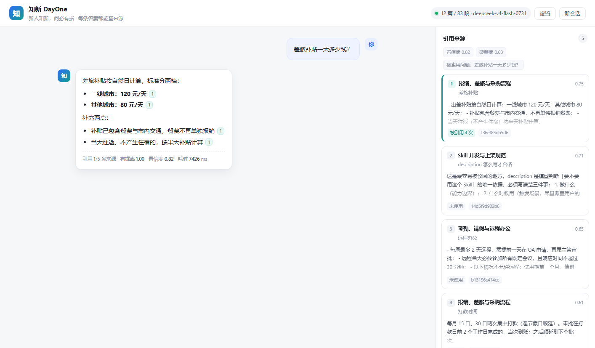

# 知新 DayOne · 入职手册知识库助手

> 新人知新，问必有据。
> 一套**通用 RAG 模板**：换知识库平台只换适配器，主流程一行不改。

**名字的由来**

- **DayOne**：入职第一天。那是新人最茫然、也最不敢开口问的一天，产品的目标就一句话——**第一天就有答案**。
- **知新**：取自「温故而知新」，也谐音**知心**。敢问的前提是不怕被笑，所以名字先要把这个态度给出来。

---

## 1. 解决什么问题

新人入职最典型的两件事：

| 痛点 | 表现 | 我们的解法 |
| --- | --- | --- |
| **不敢问** | 怕问得初级、怕打扰人，于是自己瞎猜，猜错了返工 | 匿名、随时、秒回；答案带来源编号，可自行核对原文 |
| **重复问** | 同一个「报销几天内提交」，每个新人问一遍，老员工被反复打断 | 把答案沉淀进知识库，一次入库、无限复用；问过的没答案的问题会自动进「待补充清单」 |

所以这个系统有两个硬要求：**答案必须能追溯来源**，**不知道就必须说不知道**。

### 界面



左边是对话（每条结论后面跟着可点的来源编号），右边是本次检索到的文档片段与分数，
点编号会跳到对应片段并高亮关键句；底部一行显示引用数、有据率、置信度与耗时。
（截图为真实模型 `deepseek-v4-flash` + `text-embedding-v3` 的回答）

---

## 2. 效果（真实模型实测，可复现）

35 条人工标注的入职问答（single / multi / followup / refusal 四类），
模型 `deepseek-v4-flash` + `text-embedding-v3`（1024 维）：

| 指标 | 数值 | 说明 |
| --- | --- | --- |
| Recall@5 | **1.000** | 期望文档是否进入前 5 |
| MRR | **0.984** | 第一个正确结果的平均排名 |
| nDCG@5 | **0.989** | 考虑排序位置 |
| 拒答准确率 | **1.000** | 知识库没有的问题 3/3 都拒答了，没有硬编 |
| 关键事实覆盖 | **0.969** | 回答里是否包含原文的金额/天数等硬信息 |
| 引用有据率 | **1.000** | 带引用的句子中，能在来源里找到依据的比例 |
| 平均延迟 | 4061 ms | 含检索 + 生成（流式输出，用户先看到来源） |

对比**没有 API Key 的离线兜底模式**（mock 抽取式生成 + hashing 向量，同一数据集）：

| 指标 | 离线基线 | 真实模型 |
| --- | --- | --- |
| Recall@5 | 1.000 | 1.000 |
| MRR | 0.953 | **0.984** |
| nDCG@5 | 0.963 | **0.989** |
| 关键事实覆盖 | 0.750 | **0.969** |
| 引用有据率 | 0.976 | **1.000** |

> 离线基线的作用是「没有 key 也能评审、单测不联网」；接上真模型后检索排序与生成质量都有明显提升。
> 两份报告分别保存在 `docs/评估报告.md`（真实模型）与 `docs/评估报告_离线基线.md`。
> 复现命令：`python scripts/evaluate.py --top-k 5 --with-generation`

---

## 3. 三分钟跑起来

### 3.1 本地（已有 venv，不重复装依赖）

```bash
cd DayOne    # 仓库根目录
# 本项目作者在 D:/kai_study/.venv 这套环境里验证，换机器的把下面 python 换成自己的即可

# 1) 配置（没有 key 也能跑，会自动降级为离线基线）
cp .env.example .env        # 然后按需填 LLM_API_KEY

# 2) 入库（首次会自动执行，也可手动跑）
D:/kai_study/.venv/Scripts/python.exe scripts/ingest.py

# 3) 起服务
D:/kai_study/.venv/Scripts/python.exe -m uvicorn app.main:app --port 8000
```

打开 <http://127.0.0.1:8000> 就是聊天界面；接口文档在 <http://127.0.0.1:8000/docs>。

> 本项目已针对 `D:\kai_study\.venv` 验证（Python 3.12），`requirements.txt` 里的版本与该环境一致，
> 直接复用现有环境即可，不需要 `pip install -r requirements.txt`。

### 3.2 Docker

```bash
cp .env.example .env        # 填 key
docker compose up -d --build
docker compose logs -f rag
```

### 3.3 换成公司自己的知识库（核心诉求）

三步，不改任何 RAG 代码：

```bash
# ① 选适配器：能返回 JSON 的接口 → http_json；本地文件 → local_dir
KB_SOURCE=http_json

# ② 填字段映射（你的接口字段叫什么，就映射成什么）
KB_ADAPTER_CONFIG={"base_url":"https://kb.corp.example.com/api/v1","list_path":"/documents","detail_path":"/documents/{id}","auth":{"type":"bearer","token":"xxx"},"items_path":"data.items","fields":{"id":"doc_id","title":"name","content":"content.markdown","url":"url","updated_at":"updated_at"}}

# ③ 重新入库
python scripts/ingest.py --force
```

接口结构比较特殊（GraphQL / 私有签名 / 需要拼装多个接口）时，写一个 30 行的适配器类即可，
详见 [docs/适配器开发指南.md](docs/适配器开发指南.md)。

---

## 4. 架构

```text
                    ┌──────────────────────────── 知识库源（可替换） ────────────────────────────┐
                    │  local_dir（md/pdf/docx）   http_json（任意 REST）   wecom（待接口）   你的插件  │
                    └───────────────────────────────────┬──────────────────────────────────────┘
                                                        │  KnowledgeSourceAdapter 抽象
                                    ┌───────────────────▼────────────────────┐
                                    │ 入库流水线 ingest/pipeline.py           │
                                    │ 清洗 → 结构感知切块 → Embedding → Chroma│
                                    │ 内容哈希比对，增量更新 / 删除同步        │
                                    └───────────────────┬────────────────────┘
                                                        │
  用户提问 ──► FastAPI ──► LangGraph 状态机（C-RAG）
                              condense（多轮改写）
                                 ↓
                              retrieve（Dense + BM25F + RRF + MMR + 可选重排）
                                 ↓
                              grade（置信度 / 证据覆盖度判定）
                                 ↓ 不足且未超次数
                              rewrite ──► retrieve
                                 ↓ 足够
                              generate（流式，强制 [[n]] 引用）
                                 ↓
                              verify（越界编号剔除 + 弱引用标记 + 有据率）
                                 ↓
                    SSE: 先推 sources，再逐字推 answer，最后推 done
```

### 模块职责

| 目录 | 职责 | 关键文件 |
| --- | --- | --- |
| `app/adapters/` | 知识库源适配器（插件化），只负责「外部文档 → 统一模型」 | `base.py` `http_json.py` `local_dir.py` `registry.py` |
| `app/ingest/` | 切块、向量化、落库、增量同步 | `chunker.py` `embedder.py` `store.py` `pipeline.py` |
| `app/rag/` | 检索融合、C-RAG 状态机、生成、引用校验、会话 | `retriever.py` `graph.py` `service.py` `citations.py` |
| `app/eval/` | 数据集、指标、评估执行器 | `runner.py` `metrics.py` `datasets/` |
| `app/api/` | 对外 HTTP 接口 | `routes_chat.py` `routes_kb.py` `routes_eval.py` |
| `app/web/static/` | 零构建前端（原生 JS） | `index.html` `app.js` `styles.css` |
| `data/corpus/` | 示例语料：12 篇虚构公司的入职手册 | — |

---

## 5. 五个关键设计决策

### ① 为什么用适配器模式，而不是「支持 PDF / 支持企微」

如果把「读 PDF」「读企微文档」写成 `if source == "wecom"`，每接一个平台就要改主流程，
最后必然变成一坨泥。所以我们把**变化的部分**（平台差异）和**不变的部分**（切块/检索/生成）切开：

- 适配器只做一件事：把外部文档变成 `SourceDocument(external_id, title, content, url, updated_at)`；
- 主流程只认这个结构，不 import 任何平台 SDK；
- 换平台 = 加一个类，注册进 registry；主流程 **0 改动**。

更进一步：内置的 `http_json` 适配器把「字段名、分页、鉴权」全部下沉为 JSON 配置，
**大多数平台连代码都不用写**。

### ② 为什么是混合检索（Dense + BM25F），而不是纯向量

制度类问题有大量**精确词**：「60 天」「450 元」「L3」「P1—P4」。纯向量会把「450」和「600」糊在一起，BM25 不会。
反过来，BM25 对「年假怎么算」这种口语化问法又很弱。两者用 **RRF** 融合（只看排名，不调权重），
再叠加**词面覆盖度**压制「关键词堆砌型」噪声 chunk。

实测（30 条单轮问答题，top_k=5），两种 embedding 质量下各量了一遍：

**离线 hashing 向量**（`EMBEDDING_PROVIDER=hashing`）：

| 检索方式 | Recall@5 | MRR | nDCG@5 |
| --- | --- | --- | --- |
| 纯向量 | 0.900 | 0.793 | 0.825 |
| 纯 BM25F | 1.000 | **0.961** | 0.973 |
| 混合（向量未做质量判断） | 1.000 | 0.928 | 0.948 |
| **混合（降级时自动关向量）** | 1.000 | **0.950** | 0.960 |

**真实向量**（`text-embedding-v3`）：

| 检索方式 | Recall@5 | MRR | nDCG@5 |
| --- | --- | --- | --- |
| 纯向量 | 1.000 | **1.000** | 1.000 |
| 纯 BM25F | 1.000 | 0.961 | 0.973 |
| **混合（最终版）** | 1.000 | 0.983 | 0.988 |

两件事值得说：

1. 离线那组里，**盲目融合反而更差**（0.961 → 0.928）：hashing 向量是纯词法噪声，参与投票会把 BM25 排对的文档顶下去。
   所以系统检测到降级 embedding 时会自动只用词法通道——**这一路输入不够格，就别让它投票**。
2. 换成真 embedding 后，向量通道从「噪声」变成「主力」（纯向量 MRR 1.000）。但两路确实互补：
   逐条比 top1 命中，2 条是 dense 对 bm25 错、1 条反过来（q27「账号没权限找谁审批」）。
   真实流量里编号/缩写靠词法、口语化问法靠语义，所以保留混合。

这个「先量再改、变差就撤、换模型重标」的全过程写在 [docs/调优记录.md](docs/调优记录.md)（含 4 个接真模型后才暴露的坑）。

### ③ 为什么要 LangGraph 编排，而不是一次检索硬生成

问「那其他城市呢？」这种追问，如果直接拿原句去检索，召回的是垃圾。所以流程是状态机：

```text
condense → retrieve → grade ─┬─ 足够 ────────────────► generate
                             └─ 不足 → rewrite → retrieve（最多 1 次）
```

`grade` 用**置信度 + 单块证据覆盖度**判断「知识库里到底有没有这件事」，
不足则改写重试，仍不足就明确拒答——而不是让模型自由发挥。这就是 C-RAG（Corrective RAG）的核心。

### ④ 引用怎么做到「可核对」

- Prompt 强制 `[[n]]` 编号，编号只能来自本次检索结果；
- 后处理剔除越界编号（防止编造 `[[7]]`）；
- **逐句回验**：把带编号的句子和对应 chunk 做词面重叠，低于阈值的标记为「弱引用」，前端灰显；
- 输出 `grounding_score`（有据率），评测里直接当指标用。

### ⑤ 没有 API Key 也要能跑

`LLM_PROVIDER=auto` / `EMBEDDING_PROVIDER=auto`：有 key 走真实模型，没 key 自动降级为
**抽取式 mock + hashing 向量**，并在 `/api/health` 和界面状态里**明确标注 degraded**。
好处：评审时 `docker compose up` 就能演示；单测不联网；降级从不静默。

---

## 6. 长期运行：记忆子系统

问答只能回答「手册里怎么说」，回答不了「我住哪」「材料交到哪一步了」。
`app/memory/` 补上这一层，分四类记忆：

| 层 | 存什么 | 存哪 | 生命周期 |
| --- | --- | --- | --- |
| 短期 | 本会话最近 N 轮 | `sessions.py` 进程内（生产换 Redis） | 会话结束 / TTL |
| 工作记忆 | 流程第几步、材料交了几项 | SQLite `work_items` | 流程结束 |
| 长期事实 | 部门、导师、工位 | SQLite `memory_facts`（双时间轴） | 长期，带有效期 |
| 长期偏好 | 回答风格、常用系统 | 同上（`kind=preference`） | 慢衰减 |

三个关键设计（细节见 [docs/演进设计.md](docs/演进设计.md)）：

- **冲突不是「谁新谁赢」**：事实更新封口不删除（`superseded`）、偏好保留序列、
  抽取置信度低只进 `pending`、事件时间早于旧记录时分「纠正」与「补录历史」两种意图；
- **遗忘是分级不是删除**：`active → cold → tombstone`，`dry_run` 先试算会淘汰谁；
  **工作记忆不参与衰减**（制度性状态该硬过期，不该淡忘）；
- **每个决策留痕**：来源原话、事件时间、置信度、被谁取代，全在 `audit_log` 里。

```bash
# 一条把它们串起来的故事：换地址、补材料、时间旅行、半年后淡忘
python scripts/memory_demo.py
```

接口：`POST /api/memory/facts`（写，返回 `action` 说明冲突怎么处理的）、
`GET /api/memory/facts?as_of=2026-11-03`（时间旅行）、
`GET /api/memory/work`（流程进度）、`POST /api/memory/decay`（遗忘，支持 dry_run）、
`GET /api/memory/audit`（审计）。

### 上下文预算（长对话不爆窗）

长对话会把窗口撑满，这里按「五层预算」分配（`app/context/`）：

```text
总预算 3000 tokens
├─ 输出预留 900          先扣掉，不靠挤占它塞内容
├─ 系统规则              固定
├─ 用户画像 / 流程状态    固定，超了截断
├─ 参考资料 chunks       **永不压缩**（压了引用回验就废）
└─ 对话历史              最近 2 轮原文 + 更早的摘要
```

每次响应都带 `context.layers` 与 `context.trace`，能直接看到"token 花在哪、丢了什么"：

```json
{"layers": [{"name": "chunks", "tokens": 725, "note": "5 条，不压缩"},
            {"name": "history.summary", "tokens": 136, "note": "6 轮压缩为摘要"}],
 "trace": ["预算 3000（可用 2100）→ ... ，历史可用 591"]}
```

**个人状态类问题在检索之前就分流**：问「我的流程到哪一步」不会去查文档，而是直接读档案
（`answer_source=memory`）；一问规则（「住宿标准是多少」）就交回文档链路。
不这么做的话，历史改写会把"我的进度"改写成制度问题，档案永远用不上——这是实测踩出来的。

### 工具调用（能办事，不只是能说）

问「王琳分机多少」「张伟坐哪」「我的流程走到哪一步」，这些答案不在手册里，在系统里。

- 注册表 + schema：`app/tools/registry.py`，主流程只认名字和 schema——和适配器同一套哲学；
- 两个只读工具：`get_my_onboarding_status`（读工作记忆）、`lookup_colleague`（读组织目录）；
- 路由顺序 **记忆 → 工具 → 文档**：动作型问题不该被当成关键词去检索手册；
- **身份由服务端注入**，模型不能自己填 `owner_id`（否则可以"替别人查进度"）；
- **写操作默认拒绝执行**，必须显式 `allow_write`，为下一步「提议—确认」留口子；
- 工具结果统一裁剪（`ToolResult.to_text`），并且每次调用写审计。

实测：

| 问题 | 来源 | 结果 |
| --- | --- | --- |
| 帮我查一下王琳的分机号 | tool: lookup_colleague | 8007 / 人力资源部 / 5F-B02 |
| 张伟坐在哪 | tool: lookup_colleague | 8F-A15 / 分机 8121 |
| 入职流程走到哪一步了 | tool: get_my_onboarding_status | 入职培训，缺学历证明 |
| 一线城市住宿标准 | knowledge_base | 450/600/800 元，带 [[1]] 引用 |

### 闭环探针：怎么证明它「隔天还记得、该忘的忘干净」

记忆系统最容易自欺：功能写完了，但没人验证它在时间轴上会收敛。
`app/eval/probe.py` 里是 **11 条带日期的脚本**——在固定时钟上跑到「明天 / 两周后 / 一年后 / 两年后」，
跑完逐条断言，产出「哪条断言、期望什么、实际什么」：

```bash
python scripts/probe.py                     # 11 条探针，约 0.3 秒
python scripts/probe.py --only noise_cleanup # 单条
# 报告：docs/探针报告.md（含每条的时间轴与断言明细）
```

| 探针 | 验的是什么 |
| --- | --- |
| `retention_next_day` | 昨天教的三件事，次日与两周后都答得出来 |
| `paraphrase_routing` | 「还差啥」「到哪了」仍路由到档案；问规则的不能抢答 |
| `conflict_latest_wins` | 前后矛盾以最新为准，旧值封口不删，时间旅行可查 |
| `correction_vs_backfill` | 「你记错了」与「我以前在上海」不混 |
| `noise_cleanup` | 一年不提 → 冷归档出画像；再久置 → 立墓碑 |
| `pinned_survives_decay` | 工号/部门常驻，不被当闲聊清掉 |
| `work_state_survives_decay` | 流程状态不参与淡忘；重复旧进度被打回 |
| `forgetting_traceable` | 每次降级/埋葬在审计里查得到权重与闲置天数 |
| `cross_user_isolation` | A 的信息不出现在 B 的画像与流程里 |
| `chunks_never_compressed` | 预算再紧，chunk 原文完整进上下文 |
| `summary_survives_fallback` | 摘要模型挂了也不丢历史（走抽取式兜底） |

两个刻意的设计：

- **探针必须能红**。`tests/test_probe.py` 有一条反向测试：把常驻保护关掉后，
  `pinned_survives_decay` 必须失败——断言永远绿的探针等于没写；
- **跑得快、可进 CI**。每条探针各开一套临时库并自动清理，11 条共 0.3 秒，退出码 0/1。

> 多级摘要入库、探针问句反生成、确认式写操作仍是下一阶段，设计见 `docs/演进设计.md`（P2+/P3+）。

---

## 7. 接口一览

| 方法 | 路径 | 用途 |
| --- | --- | --- |
| POST | `/api/chat` | 一次性问答，返回答案 + 来源 + 引用 + 指标 |
| POST | `/api/chat/stream` | SSE 流式：`start / status / sources / delta / done` |
| POST | `/api/chat/reset` | 清空某会话的多轮记忆 |
| POST | `/api/feedback` | 「这个问题没答案」，落盘 `data/feedback.jsonl` |
| GET | `/api/health` | 健康检查（模型、降级状态、知识库规模、适配器列表） |
| GET | `/api/kb/stats` | 文档数 / 分块数 / 文档清单 |
| GET | `/api/kb/adapters` | 已注册适配器 |
| GET | `/api/kb/adapters/{name}/probe` | 探测某个适配器能否拉到目录（不落库） |
| POST | `/api/kb/ingest` | 触发入库（`force` / `reset` / `limit`） |
| POST | `/api/kb/search` | 检索调试：只看召回，不生成 |
| GET | `/api/eval/dataset` · POST `/api/eval/run` · GET `/api/eval/last` | 评估集与评估报告 |

```bash
# 一次性问答
curl -s -X POST http://127.0.0.1:8000/api/chat \
  -H 'Content-Type: application/json' \
  -d '{"question":"报销单必须在多久内提交？"}' | python -m json.tool

# 流式
curl -N -X POST http://127.0.0.1:8000/api/chat/stream \
  -H 'Content-Type: application/json' \
  -d '{"question":"每周最多可以远程办公几天？"}'

# 检索调试（看 dense / bm25 / 融合分）
curl -s -X POST http://127.0.0.1:8000/api/kb/search \
  -H 'Content-Type: application/json' \
  -d '{"query":"住宿标准","top_k":3}'
```

返回体（节选）：

```json
{
  "answer": "消费发生后 **60 天内**提交报销单，逾期系统自动关闭[[2]]。",
  "sources": [{"n": 2, "doc_title": "报销、差旅与采购流程", "heading": "报销基本规则", "score": 0.83}],
  "citations": [{"n": 2, "used": true, "hits": 1}],
  "confidence": 0.62, "grounding_score": 1.0, "refused": false,
  "standalone_query": "报销单必须在多久内提交？", "latency_ms": 780
}
```

---

## 8. 评估与调优

```bash
# 只评检索（快、不花 token）
python scripts/evaluate.py --top-k 5

# 连生成一起评（需要真模型才有意义）
python scripts/evaluate.py --top-k 5 --with-generation

# 参数扫描（融合权重 / BM25 长度归一 / 标题权重）
python scripts/tune.py --top-k 3
```

数据集格式（一行一条）：`question` / `expected_docs` / `must_contain` / `type` / `history`，
见 `app/eval/datasets/golden_onboarding.jsonl`。新增语料时**同步补用例**，否则调优就是盲调。

---

## 9. 目录结构

```text
DayOne/
├── app/
│   ├── main.py                 # FastAPI 入口、lifespan、异常处理、静态资源
│   ├── config.py               # 全部配置（pydantic-settings，读 .env）
│   ├── adapters/               # ★ 知识库适配器（插件化核心）
│   ├── ingest/                 # 切块 / embedding / Chroma / 增量流水线
│   ├── rag/                    # 混合检索、LangGraph、生成、引用、会话
│   ├── eval/                   # 评估集 + 指标 + 执行器
│   ├── api/                    # 路由 + 数据契约 + 鉴权
│   ├── core/                   # 日志、异常
│   └── web/static/             # 前端（原生 JS，无构建）
├── data/corpus/                # 12 篇示例入职手册
├── docs/
│   ├── 技术栈说明.md            # ★ 每项技术在哪个文件、干什么用
│   ├── 架构设计.md
│   ├── 适配器开发指南.md
│   ├── 评估报告.md              # 脚本生成
│   └── 调优记录.md              # 三轮调优的 before/after
├── scripts/                    # ingest / evaluate / tune / ask
├── tests/                      # 27 个单测 + 接口冒烟
├── Dockerfile · docker-compose.yml
├── requirements.txt · .env.example
└── README.md
```

---

## 10. 已实现 / 未实现

**已实现**

- 适配器插件化（内置 local_dir / http_json / wecom 占位 + 外部模块加载 + 多源并行挂载）
- 增量入库（内容哈希比对、下线文档清理、集合名带模型指纹避免维度冲突）
- 混合检索（Dense + BM25F + RRF + 词面覆盖度 + MMR + 可选 LLM 重排）
- 多轮追问（LangGraph 查询改写 + 会话记忆 + TTL）
- 来源标注与引用高亮（`[[n]]` 协议 + 逐句回验 + 前端点击定位高亮）
- **记忆子系统**（工作记忆 / 长期事实 / 双时间轴冲突 / 三级遗忘 / 审计日志 / 统一时钟支持时间旅行）
- **上下文预算**（五层分配 / 资料不压缩 / 旧历史摘要 / 个人状态问题检索前分流）
- **工具调用**（注册表 / 执行器 / 路由 / 只读白名单 / 身份注入 / 审计）
- **闭环探针**（11 条：跨天保留 / 冲突 / 遗忘 / 隔离 / 压缩不吞证据，附报告）
- 拒答兜底、SSE 流式、离线降级、Docker 化、评估脚本与 62 个测试

**没做（有意为之，避免过度设计）**

- 用户体系与权限隔离（当前是内网单租户；接企微可拿 userid 做过滤）
- 会话持久化（内存 + TTL，多副本需换 Redis，`sessions.py` 已按 kv 抽象）
- 向量库分布式（Chroma 单机够用；上量换 pgvector / Milvus，只改 `store.py`）
- 定时增量同步（现在靠脚本/接口触发；接 cron 或 APScheduler 即可）

---

## 11. 常见问题

**Q：没有 API Key 能演示吗？**
能。会自动用离线基线，界面状态栏会显示「离线基线模式」，不静默降级。

**Q：换个 embedding 模型要不要重建库？**
要。集合名带 `provider__model__dim` 指纹，新模型会自动建新集合，跑一次 `ingest.py --force` 即可，旧集合可直接删。

**Q：为什么回答有时把表格表头也列出来？**
离线抽取式基线只挑句子不做总结，属于基线特性；接真实模型后不会有这个问题。

**Q：知识库里没有的问题，会不会硬编？**
不会。`grade` 节点判定不足会直接走兜底话术，并在返回体里 `refused=true`，同时把召回到的近似文档列出来供你判断。

---

## 12. 技术栈索引

FastAPI / Docker / LangGraph / Chroma / Embedding / RAG 各自「用在哪、干什么」，
见 **[docs/技术栈说明.md](docs/技术栈说明.md)**（含文件路径与函数名）。
